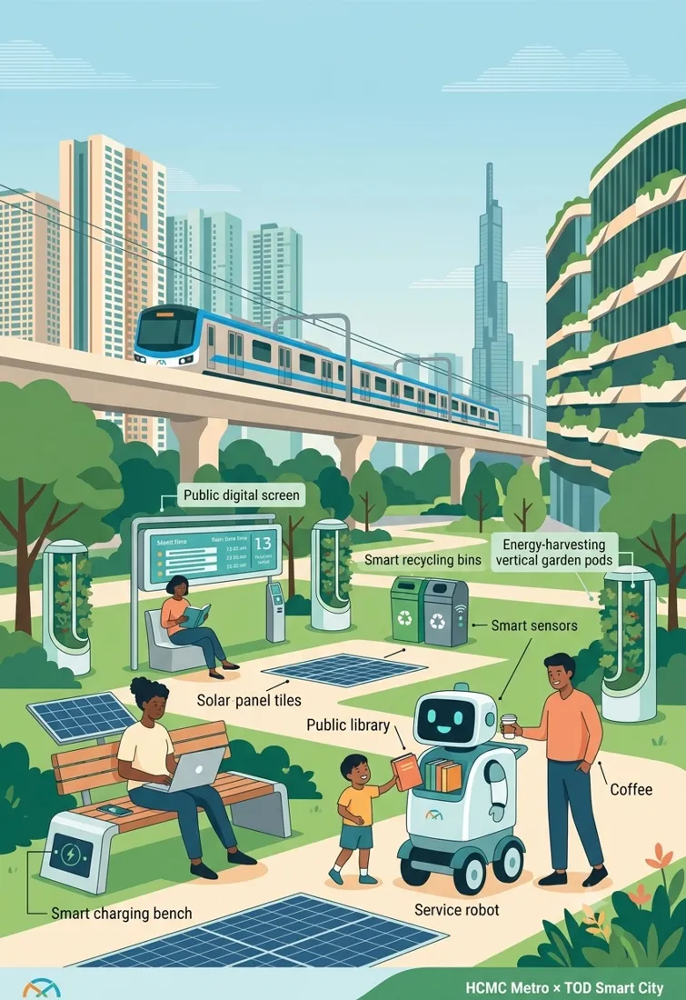
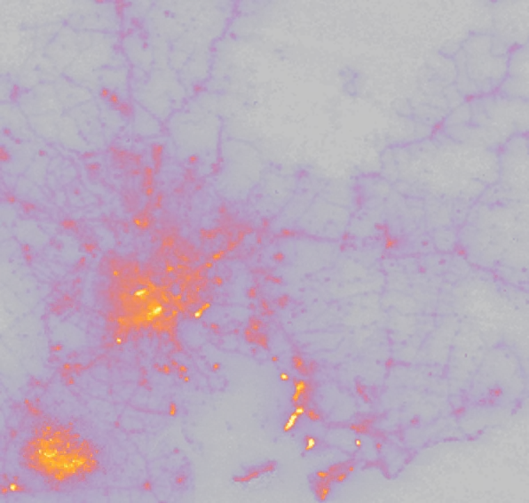
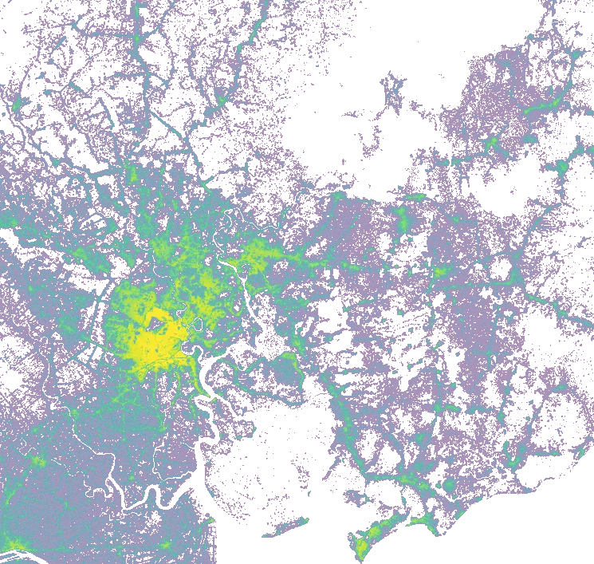

# Metro Line 1 and asking prices in Ho Chi Minh City: interactive evidence site

## Overview

Bilingual (English/Vietnamese) static website that accompanies a Fulbright MPP thesis on Ho Chi Minh City Metro Line 1 (Truong Nhat Duy, 2025–2027). It asks how asking prices near the line relate to access to a station, and what that evidence allows us to say about land value capture design.

Live site: https://truong-nhat-duy.github.io/metro1-hcmc-site/

Status: work in progress. Everything shown is descriptive. The data are asking prices posted after the line opened on 22 December 2024, with no pre-opening period, so nothing on this site is a causal estimate.

## What the site shows

- Summary, policy problem, research questions, data pipeline and models.
- Theory framework, prior studies compared with this thesis, line-stage results.
- Interactive listing map around Line 1 with popups (distance to nearest station, ring premium, local density), distance-ring maps, the whole Ho Chi Minh City network, and a Hanoi comparison.
- Hedonic ring coefficients, machine-learning fit and SHAP, station-level discontinuities, supplementary exploratory results.
- Night-light maps by year (VIIRS, 2019–2026), population density by year for Ho Chi Minh City and Hanoi (WorldPop), land-use mix and amenity layers.
- Current provincial boundaries (from 1 July 2025), 800 m catchments of every station, and a land value capture arithmetic calculator marked as an illustration.
- Heterogeneity and rents: price-percentile gradient, seller-stated rents by distance ring and a heterogeneity summary. No market rent series exists in the data.
- Maps use one station symbol (an “M” badge: filled = operating, red = under construction, dashed = planned) and draw the planned east and west extensions of Line 1 as a dashed, schematic layer that can be switched off.
- Theory in pictures: concentric rings at city and station scale, an adjustable illustration of how a station is capitalised into land value, a timeline of the expectation and operation phases against the data window, and an interactive reading of the regression equation. All are illustrations; only the ring bars are estimates.
- Check a place (Vietnam-wide): pick a place by location, province or station menu, or click the map. The page shows the nearest metro station with the walk to it (OpenStreetMap walking network, 120 m grid, up to 3 km from each Ho Chi Minh City and Hanoi station; straight line × detour factor beyond that), a bus route that links to a station with estimated ride and waiting time (assumed speed; half the OSM `interval` headway tag), and the everyday amenities (schools, health care, parks, shops and markets, bus stops) within a 5, 10 or 15 minute walk. Optional layers: 34 provinces after the 1 July 2025 merger, 63 GADM provinces, ring roads and expressways, railways and metro lines, bus routes, amenities by 0.5° tile, and key facilities across Vietnam (OpenStreetMap).
- Developers and projects: exposure of apartment developers to operating, under-construction and planned stations (800 m), a project map with a developer filter, and a scenario calculator. Exposure is not benefit; the data are a tracking run limited to the former city area.

## What the data are, and are not

- Asking prices from public online listing platforms (Chợ Tốt and GuLand), after 22 December 2024. The platform names identify the sources only; there is no affiliation with or endorsement by either.
- Not transaction prices. Asking prices usually differ from the price agreed after negotiation.
- Not de-duplicated across platforms (no reliable key links the same listing across sources). Many listings share a coordinate or carry an approximate location, so the number of listings is not the number of independent properties.
- Listings are scarce close to stations: only a few per cent lie within 500 m, so station-level estimates rest on few buildings.
- Station coordinates for lines other than Line 1 are partly unverified (OpenStreetMap and planning documents) and are drawn as schematic.

## Privacy and personal data

- The repository contains no seller names, phone numbers, accounts, listing text, listing URLs or listing IDs. Raw scraped files are not published.
- The published listing sample (4,782 Ho Chi Minh City points, 5,582 Hanoi points) holds only rounded coordinates (4 decimals, about 11 m), price per m², property type, distance to the nearest station and distance ring.
- Cleaned data and analysis code are kept in a separate private repository and are not part of this site.
- Visitors: the site sets no cookies, runs no analytics, tracking or forms, and stores only your language and theme choice in your browser (localStorage). The connectivity explorer asks your browser for your location only when you press the button; the position is used in the page and is never sent or stored by this site.
- If you are a rights holder or a person affected and want a record removed, open a GitHub issue without personal data in it and it will be reviewed promptly.

## Security and third-party requests

- Static files only: no server-side code, database, login or API. No keys, tokens or credentials are in the repository.
- Leaflet 1.9.4 and Chart.js 4.4.1 are bundled in the repository, not loaded from a CDN.
- Your browser does contact third parties when you open the page: Esri and OpenStreetMap tile servers for base maps, and Google Fonts for typefaces. Those providers can see your IP address under their own policies.
- To report a security problem, open a GitHub issue without exploit details or personal data, or use GitHub’s private vulnerability reporting if it is enabled for this repository.

## Method and main numbers in brief

- Hedonic regressions of ln asking price per m² on ln distance to the nearest station, with property attributes, distance to the centre and location fixed effects; local-linear spatial discontinuity checks at 500 m and 800 m as diagnostics only; spatial lag, error and Durbin models; geographically weighted regression and random forest with SHAP for exploration.
- Pooled Chợ Tốt–GuLand run of 24 October 2026 (exploratory, not frozen): 35,528 listings with common support, 34,174 after trimming. Elasticity of asking price to distance −0.263 (95% CI −0.302 to −0.225) with 5 km cell fixed effects; −0.089 (95% CI −0.228 to 0.049) with 500 m cell fixed effects.
- Reading: a continuous gradient, no support for a step at conventional radii, and much of the raw gradient is location. The effect of the Metro itself is not identified.
- Daily runs only monitor. A paper uses one run frozen on a date declared in advance; later data are holdout and the specification is not changed after seeing results.

## Limitations

- No pre-opening period and no transaction prices: difference-in-differences, event studies and any causal reading are not possible with the current data.
- Results are sensitive to the fineness of location fixed effects and to the spatial weight matrix.
- WorldPop is a modelled estimate, so year-to-year change is smooth by construction; night-light, land-use and amenity layers are context, not outcomes of the metro.
- OpenStreetMap land-use polygons cover roughly a third of the area.
- Administrative boundaries are from OpenStreetMap (HCMC wards and communes, 10 October 2026 extract, 167 units) and GADM 4.1; Hanoi shows the provincial outline only.
- The land value capture calculator is arithmetic for illustration, not a forecast of revenue.

## Sources, attribution and licences

- OpenStreetMap contributors (ODbL): boundaries, amenities, land use, base map.
- Esri base maps. NASA/VIIRS Black Marble VNP46A3 (night lights). WorldPop R2025A (population, CC BY 4.0). ESA WorldCover 2021 (land cover, CC BY 4.0).
- GADM 4.1 (administrative outlines): GADM data are free for academic use and other non-commercial use only; redistribution and commercial use are not allowed without GADM’s permission. The outlines on this site are simplified, derived copies shown solely for non-commercial academic visualisation. They are not covered by this repository’s licence. Anyone reusing them should download the original data from gadm.org and follow its terms.
- Chợ Tốt and GuLand are named only to identify the sources of the listings.
- Full list of third-party components and terms: THIRD_PARTY_NOTICES.md.

## Repository contents and data dictionary

- README.md, LICENSE (CC BY-NC 4.0) and THIRD_PARTY_NOTICES.md: documentation, licence and third-party terms.
- index.html, style.css, app.js, x.js, x2.js, maps.js, net.js: page and interactive code.
- conn.js and data/*.json: connectivity explorer and its lazily loaded layers (prov34, gadm1, roads, rail, bus_routes with `iv`/`oh` headway and opening-hours tags, poi_vn, walkgrid, amen_index and amen/ tiles (nationwide amenities)), derived from OpenStreetMap (10 Oct 2026 extract) and GADM 4.1; bus data are incomplete, there is no GTFS timetable, and walkgrid is a 120 m approximation (about ±100 m snapping error, 65 of 70 HCMC and 20 of 22 Hanoi stations could be attached to the walking network).
- data*.js: embedded data (listing sample, results, boundaries, station network). assets/: images, night-light and population overlays (webp) with metadata. vendor/: Leaflet and Chart.js.
- Run locally: serve the folder with any static server, for example python -m http.server 8000, then open http://localhost:8000.

## Images, overlays and where to find them

- assets/img/tod_smartcity.webp (755×1100): banner of the Summary part. tod_campus.webp (1024×572): Theory part. quad_panels.webp (1024×559): Findings part. gis_robot.webp (1024×434): Data and method part and the maps-and-results part. hcmc_banner.webp (1584×672): Ho Chi Minh City maps part. tod_wide.webp (1200×734): context-layers part. fulbright_campus.webp (1024×572): policy part.
- assets/img/hanoi_scene.webp (1024×559): Hanoi section background. emblem.webp (720×720): About block. p_hcmc.webp, p_hanoi.webp, p_park.webp, p_emblem.webp (256×559 portrait crops) and assets/banner_photo.png are currently unused.
- assets/hero.jpg (1200×670) and assets/hero_scene.jpg (1375×596): hero backgrounds. assets/logo.png (256×256) and assets/logo_banner.png (1408×768): logo. assets/qr.png (546×546): QR code to the live site.
- assets/ntl/ntl_2019.webp to ntl_2026.webp, ntl_change.webp and meta.json: night-light overlays (VIIRS VNP46A3) with the bounds and statistics used on the map.
- assets/ntl_hn/ and ntl_hn.js: Hanoi night-light overlays (VIIRS VNP46A3, 2019–2026) and ring index (2023 = 100) around 22 operating stations from OpenStreetMap (unverified); descriptive only.
- sale.js and data/sale_hcm|bd|brvt|hn.json: for-sale asking-price dots (Guland map markers; coordinates, price per m² and type only; cleaned, deduplicated). fs.js: full-screen button on every map. Top block: "Where do you want to go?" (conn.js) now sits right under the hero.
- assets/pop/pop_2015.webp to pop_2026.webp, pop_change.webp and meta.json: Ho Chi Minh City population density overlays (WorldPop R2025A). assets/pop_hn/ holds the same for Hanoi.
- Overlays are transparent and drawn over the base map on the site, so on GitHub they look pale; the live site shows them as intended.
- Source and rights of the photographs and illustrations under assets/img are not yet documented in this repository.

## Licence

- Text, figures, tables, code and the website of this repository are licensed under Creative Commons Attribution-NonCommercial 4.0 International (CC BY-NC 4.0). You may share and adapt them with attribution and for non-commercial purposes only. Full text in the LICENSE file.
- Not covered by this licence: third-party data, libraries, fonts and base maps (see THIRD_PARTY_NOTICES.md); the GADM-derived outlines; and the photographs and illustrations under assets/ (their source and rights are not yet documented here, so they remain with their owners).
- Non-commercial use also matches the GADM terms. For any commercial use, ask the author and check each third-party source separately.
- CC BY-NC is not a software licence. If you want the code to be reusable under MIT or Apache-2.0, say so in a GitHub issue.

## Responsible use and citation

- This is academic research in progress, not an official product of any government body. It is not financial, legal, tax or investment advice, and must not be used to set taxes, fees or valuations. Provided as is, without warranty.
- Please cite: Truong, N. D. (2026). Metro Line 1 and asking prices in Ho Chi Minh City: interactive evidence site (work in progress). https://truong-nhat-duy.github.io/metro1-hcmc-site/
- Fulbright School of Public Policy and Management, MPP 2025–2027. Last updated 27 October 2026.

## Image index

Relative paths, so they work on GitHub and on the live site.

| Image | Path | Size | Where it is used |
|---|---|---|---|
|  | `assets/img/tod_smartcity.webp` | 755×1100 | Summary banner |
|  | `assets/img/tod_campus.webp` | 1024×572 | Theory banner |
|  | `assets/img/quad_panels.webp` | 1024×559 | Findings banner |
|  | `assets/img/gis_robot.webp` | 1024×434 | Data and method banner, results banner |
|  | `assets/img/hcmc_banner.webp` | 1584×672 | Ho Chi Minh City maps banner |
|  | `assets/img/tod_wide.webp` | 1200×734 | Context-layers banner |
|  | `assets/img/fulbright_campus.webp` | 1024×572 | Policy banner |
|  | `assets/img/hanoi_scene.webp` | 1024×559 | Hanoi section background |
|  | `assets/img/emblem.webp` | 720×720 | About block |

Data overlays (transparent, drawn over the base map on the live site):

| Layer | Path pattern | Years |
|---|---|---|
| Night lights, Ho Chi Minh City | `assets/ntl/ntl_<year>.webp`, `ntl_change.webp`, `meta.json` | 2019 to 2026 |
| Population density, Ho Chi Minh City | `assets/pop/pop_<year>.webp`, `pop_change.webp`, `meta.json` | 2015 to 2026 |
| Population density, Hanoi | `assets/pop_hn/pop_<year>.webp`, `pop_change.webp`, `meta.json` | 2015 to 2026 |

Examples:   

The source and rights of the photographs and illustrations in `assets/img/` are not yet documented here, and they are excluded from the licence.
